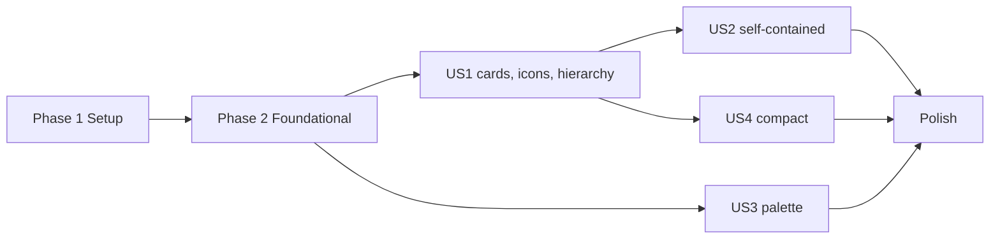

---

description: "Task list for feature 020: Diagram Look"
---

# Tasks: Diagram Look

**Input**: Design documents from `specs/020-diagram-look/`

**Prerequisites**: plan.md, spec.md, research.md (R1–R13), data-model.md, contracts/svg-output.md, quickstart.md

**Tests**: Included. Constitution Principle V (Test-First) applies, and plan.md lists the required tests: icon-table completeness, label plan, SVG pass, contrast, byte identity. Write each test task first and confirm it fails before the matching implementation task.

**Organization**: Tasks are grouped by user story. Each story is an increment that you can test on its own.

## Format: `[ID] [P?] [Story] Description`

- **[P]**: Can run in parallel (different files, no dependency on an incomplete task)
- **[Story]**: The user story the task serves (US1–US4)
- All paths are relative to the repository root

## Conventions for every task

- Go 1.27, single module. The change stays in `internal/adapters/d2/` and `internal/core/entities/viewmodel/style.go`. No new module.
- Adapter files stay at or below 400 effective lines. `style.go` stays at or below 200.
- Golden files are rewritten with the package's `-update` flag (`internal/adapters/d2/emit_test.go` and `cmd/projection_golden_test.go` each define `update`). Review every golden diff before you commit it.
- Output must stay byte-identical across runs (FR-015). Never iterate a map to produce output. Sort first.

---

## Phase 1: Setup (Shared Infrastructure)

**Purpose**: Record the "before" state and vendor the icon files.

- [X] T001 Record the baseline before you change code. Run `git worktree add /tmp/loko-base HEAD` and `go build -o /tmp/loko-before .` inside `/tmp/loko-base`. For each project directory under `examples/` that holds `*.loko.hcl` files (`3layer-app`, `microservices`, `serverless`, `simple-project`) and for `testdata/projects/dynamic-views`, run `/tmp/loko-before build --format svg --out /tmp/before/<name>`. Write every `diagrams/*.svg` viewBox and the total SVG byte count per project to `/tmp/before/sizes.txt`. T031 and T037 compare against this file.
- [X] T002 [P] Vendor the icons. From one pinned `lucide-static` release, copy `icons/database.svg`, `list-ordered.svg`, `megaphone.svg`, `square-function.svg`, `archive.svg`, `user.svg`, `boxes.svg`, `container.svg`, `blocks.svg` and `globe.svg` unmodified into `internal/adapters/d2/icons/`. Copy Lucide's ISC `LICENSE` unmodified to `internal/adapters/d2/icons/LICENSE` (FR-004, research R7). Keep a note of the release version and source URL for T012.
- [X] T003 [P] Ship the Lucide notice in release archives. In `.goreleaser.yaml`, under `archives[].files`, add an entry with `src: internal/adapters/d2/icons/LICENSE` and `dst: LICENSE-lucide`. If `goreleaser` is installed, run `goreleaser check`.

---

## Phase 2: Foundational (Blocking Prerequisites)

**Purpose**: The line-role table and the label-plan value. The emitter (US1), the SVG pass (US1, US4) and the contrast test (US3) all read them.

**⚠️ CRITICAL**: Complete this phase before you start a user story.

- [X] T004 Create `internal/adapters/d2/labelstyle.go`. Define `type LineRole uint8` with the roles `roleTitle`, `roleKind`, `roleBlank`, `roleDescription`, `roleEdgeLabel`, `roleEdgeTech`, `roleEdgeTags` (data-model "Label line roles"). Define one table, `lineStyles`, from role to `lineStyle{css string; regular bool; opacity float64; size float64}`. `size` is in em of d2's 16px. `regular` tells the pass to put `font-family:<hash>-font-regular;` before `css` (research R3). Use these values verbatim: title `""`, false, 1, 1. Kind `font-size:0.7em;letter-spacing:0.06em;fill-opacity:0.85`, false, 0.85, 0.7. Blank `""`, false, 1, 1. Description `font-size:0.9em;fill-opacity:0.9`, true, 0.9, 0.9. EdgeLabel `""`, false, 1, 1. EdgeTech `font-size:0.75em;letter-spacing:0.04em;fill-opacity:0.8`, false, 0.8, 0.75. EdgeTags `font-size:0.75em;fill-opacity:0.72`, false, 0.72, 0.75. No role sets `font-weight`, because d2 embeds each weight as its own font family (research R3). This table is the only place that holds text styles (FR-011).
- [X] T005 Add the label-plan types at the top of a new file `internal/adapters/d2/emit_label.go`. Add `NodePlan{Icon string; Colour string; Lines []LineRole}` and `LabelPlan{Nodes map[string]NodePlan; Edges map[string][]LineRole}`. Add `labelLine{text string; role LineRole}` and `joinLines([]labelLine) (string, []LineRole)`, which joins texts with `\n` and returns the roles in the same order. Add `(LabelPlan) Key() []byte`, a deterministic serialisation with sorted node keys and sorted edge keys, for the render-cache key (research R10). Invariant from data-model: `len(Lines)` equals the number of lines in the emitted label.

**Checkpoint**: `go build ./...` passes. User-story work can start.

---

## Phase 3: User Story 1 - Read an element at a glance (Priority: P1) 🎯 MVP

**Goal**: Every element and instance is a rounded card with a corner icon chosen by its shape, then its kind. Its label reads: bold name, small kind line (`CONTAINER · Go, gRPC`), lighter description.

**Independent Test**: Build `examples/microservices` and open its system and container views. Every element is a card with the icon for its kind or declared shape. On every card, the name is heavier than the kind line, and the kind line is smaller than the description.

### Tests for User Story 1 (write first, confirm they fail)

- [X] T006 [P] [US1] Rewrite the expectations in `internal/adapters/d2/emit_title_test.go` for the new kind line (research R8). Titled: `Orders API\nCONTAINER · Go · api\n\nServes orders`. Untitled: `api\nCONTAINER · Go\n\nServes orders`. Titled with no technology: prefix `Orders API\nCONTAINER · api`. Add cases: no technology and no title gives the kind line `SYSTEM` only. No description gives a label that ends with the kind line and has no trailing blank line. Technology `Go, gRPC` keeps its casing. A titled element with no kind gives `ELEMENT · <name>`. In `TestLongTitleWrapsAndRenders`, cut the title at the first `\n` that starts the kind line, not at `\n[`.
- [X] T007 [P] [US1] Write `internal/adapters/d2/emit_label_test.go` for the label plan that `emitPlanned` (T014) returns. Roles: untitled with technology and description gives `[title, kind, blank, description]`. A title wrapped over three lines gives three `title` entries first. No description gives `[title, kind]`. A description with an embedded newline gives one `description` entry per line. Nodes: element and `RoleInstance` nodes are present, keyed by the `pathIndex` path (for example `"system__shop"."container__api"`). `NodePlan.Colour` equals `n.Style.FontColor`. Subject boundaries, groups and outside nodes are absent. Edges: description and technology give `[edgeLabel, edgeTech]`. Technology only gives `[edgeTech]`. Description, technology and tags give `[edgeLabel, edgeTech, edgeTags]`. A description with an embedded newline and no technology gives `[edgeLabel, edgeLabel]` and is absent from the plan. An edge with a description only is absent. Two edges between the same pair get keys with indexes `[0]` and `[1]`. For every entry, check `len(Lines) == strings.Count(label, "\n")+1`. Emit the same view model twice and check that the plans are `reflect.DeepEqual` (FR-015).
- [X] T008 [P] [US1] Write `internal/adapters/d2/icons_test.go` (FR-017). For every value in `arch.Shapes`, `shapeIcons[vm.Shape(s)]` exists. For every value in `arch.AllElementKinds`, `kindIcons[string(k)]` exists. Check the FR-002 table: database→`database`, queue→`list-ordered`, topic→`megaphone`, function→`square-function`, bucket→`archive`, person→`user`, system→`boxes`, container→`container`, component→`blocks`, external→`globe`. Check that `iconFor(vm.ShapePerson, "person")` is `user`, that a declared shape wins over the kind, and that an unknown kind falls back to `boxes`. For every icon name in the tables, `iconSymbol(name)` starts with `<symbol id="loko-icon-<name>" viewBox="0 0 24 24">`, ends with `</symbol>`, and contains no `<svg`, no `xmlns` and no `http`.
- [X] T009 [P] [US1] Rewrite `internal/adapters/d2/emit_shape_test.go` as `TestShapesAreCards`. For each value in `arch.Shapes`, the emitted D2 contains `shape: rectangle` and `border-radius: 6` (research R13), and none of `c4-person`, `cylinder`, `queue`, `hexagon`, `step`, `stored_data` as a shape. The node's `class:` list contains `shape-<shape>`, and the `classes` block declares it (research R12, FR-016). A container without `shape` has no `shape-*` class. The plan's `NodePlan.Icon` is the FR-002 icon for that shape. The source still compiles with `compile`.
- [X] T010 [P] [US1] Write `internal/adapters/d2/svgpass_test.go`. Render `emitCases()["subject"]`, `["landscape"]`, `["deployment"]` and one container with `shape = "database"` through `emitPlanned`, `compile` and `applyPlan`. Find each node group by its first class. d2 writes it as `base64.URLEncoding` of `svg.EscapeText(id)` (`d2svg.go` 1627). Check contracts/svg-output.md items 1–7: one `<defs>` that holds a `<symbol id="loko-icon-<name>">` for each icon used and no others (set equality). Each element and instance group holds exactly one `<use class="loko-icon" href="#loko-icon-<name>"` with `width="16" height="16"`, x and y 4px inside the card `<rect>`, `color` set to the card's font colour, and `fill="none" stroke="currentColor" stroke-width="2" stroke-linecap="round" stroke-linejoin="round"`. The card `<rect>` has `rx="6"`. Subject, group and outside groups hold no `<use`. In each card's `<text>`, the kind tspan carries the kind style. The description tspan carries `font-family:<hash>-font-regular;` followed by the description style, where `<hash>` is the hash in the SVG's own `-font-bold` family name. No tspan has `font-weight`. Title and blank tspans have no added style. The SVG holds an `@font-face` for `<hash>-font-regular`, also for a view with no edge labels. In edge labels, technology and tag tspans carry their style and the description tspan is unchanged. The `kind-*`, `tag-*`, `shape-*` and `external` classes are on the expected groups (FR-014). A view with no element card gets no `loko-icon` `<defs>`.
- [X] T011 [P] [US1] Extend `internal/adapters/d2/svg_backend_test.go`. Cache key: render two views whose D2 sources are equal but whose plans differ. View A has an edge with description `x` and technology `y`. View B has an edge with description `x\ny` and no technology. The second render is a cache miss (`cacheHits` does not change), and only view A's second edge-label tspan carries the edgeTech style (research R10). Byte identity: two new `SVGBackend`s render the same projection to byte-identical artifacts (FR-015, SC-006).

### Implementation for User Story 1

- [X] T012 [P] [US1] Create `internal/adapters/d2/icons.go`. Embed the files with `//go:embed icons/*.svg`. Define `shapeIcons` (`vm.Shape` → icon name, including `ShapePerson` → `user` and the five FR-002 shapes) and `kindIcons` (kind → icon name, the five kinds). `iconFor(shape vm.Shape, kind string) string` looks up the shape first, then the kind, then returns `boxes`. `iconSymbol(name string) string` returns `<symbol id="loko-icon-<name>" viewBox="0 0 24 24">` + the inner elements of the Lucide file (the content between the root `<svg …>` start tag and `</svg>`, trimmed) + `</symbol>`. Build all symbols once with `sync.OnceValue`. Put the pinned `lucide-static` version, the source URL and "ISC, see icons/LICENSE" in the file's doc comment (research R7).
- [X] T013 [US1] Move label building from `internal/adapters/d2/emit.go` to `internal/adapters/d2/emit_label.go`: `kindTitles`, `nodeLabel`, `edgeLabel`, `baseEdgeLabel`, `titleWidth`, `wrapTitle`, `groupLabel`. Change `kindTitles` to `PERSON`, `SYSTEM`, `CONTAINER`, `COMPONENT`, `EXTERNAL`, with `ELEMENT` as the fallback for a titled node with no kind. Make `nodeLabel` return `[]labelLine`. Each line of `wrapTitle(n.Title)`, or the name when untitled, is a `roleTitle` line. The kind line is `roleKind`: the upper-case kind, then ` · <technology as written>` when set, then ` · <name>` when titled (FR-005). When a description is set and the role is not `RoleSubject`, add a `roleBlank` line and one `roleDescription` line per description line. Do not change the label text of boundaries and outside nodes: `groupLabel`, the subject's `Name\n[Kind]` label and the outside label stay as today (FR-013). Make `edgeLabel` return `[]labelLine`: the description is `roleEdgeLabel`, the bare technology without brackets is `roleEdgeTech` (R8), and `#tag #tag` is `roleEdgeTags`.
- [X] T014 [US1] Update `internal/adapters/d2/emit.go` (depends on T012, T013). Add `emitPlanned(m vm.ViewModel) ([]byte, LabelPlan)`. `Emit` returns only its bytes, for `SourceBackend` and the tests. In `writeNode`, write `shape: rectangle` and `style.border-radius: 6` for element and instance nodes (research R13). When `n.Style.Shape` is one of the declared element shapes (`database`, `queue`, `topic`, `function`, `bucket`), add `shape-<shape>` to the node's `class:` list in sorted order, and make `writeClasses` declare it (research R12). Record `NodePlan{Icon: iconFor(n.Style.Shape, n.Kind), Colour: n.Style.FontColor, Lines: roles}` under the node's `pathIndex` path. Boundaries keep `rectangle` with square corners and outside nodes keep `oval`. Remove the `ShapePerson`, `ShapeDatabase`, `ShapeQueue`, `ShapeTopic`, `ShapeFunction` and `ShapeBucket` cases from `d2Shape`, because no caller needs them now. In `writeEdge`, record edges that have an `edgeTech` or `edgeTags` line under the key d2 gives the edge (`(<src> -> <dst>)[<n>]`, where `n` counts earlier edges with the same source and target from 0). Confirm the exact key form against the first class of an edge group in a rendered SVG. Include a nested path and a path that needs quotes.
- [X] T015 [US1] Update `internal/adapters/d2/emit_sequence.go` so participants and step arrows go through the same label and plan path (FR-018, research R9). `emitSequence` returns `([]byte, LabelPlan)` and `emitPlanned` dispatches to it. Participant keys use the absolute path under `loko-flow`. Step arrows record their edge roles. Confirm both key forms against a rendered sequence SVG.
- [X] T016 [P] [US1] Create `internal/adapters/d2/svgpass.go` with `applyPlan(doc []byte, plan LabelPlan, fontHash string) []byte` (research R1, R2, R3, R10). Name the parameter `doc`, not `svg`, so that d2's `lib/svg` package stays visible. Use one linear scan over the bytes. Do not use an XML parser. For each `<g class="<id> …">`, look up the first class in a map built once from the plan keys with `base64.URLEncoding.EncodeToString([]byte(svg.EscapeText(key)))`, the encoding d2 uses (`d2svg.go` 1627). For a node, read the card `<rect>` x and y and insert `<use class="loko-icon" href="#loko-icon-<icon>" x="<x+4>" y="<y+4>" width="16" height="16" color="<Colour>"/>` after it. Lucide's stroke attributes live in each `<symbol>` (research R7). Add a `style` attribute to the i-th `<tspan>` of the group's `<text>` when its role has css. The value is `font-family:<fontHash>-font-regular;` + css when `regular` is set, and css alone otherwise. For an edge, style its label tspans the same way. Insert one `<defs>` that holds `iconSymbol` for each icon used, sorted by name, after the outermost `<svg …>` start tag. When the plan has no nodes, add no `<defs>`. Format numbers with `strconv.FormatFloat(v, 'f', -1, 64)` so that output stays byte-identical.
- [X] T017 [US1] Update `internal/adapters/d2/svg_backend.go`. `renderView` calls `emitPlanned`. `cached` keys on `sha256(src || 0x00 || plan.Key())`. Change `compile` to return the SVG and the font hash, read from the class d2 gives its inner `<svg>` (`d2-<n>`, which is `diagram.HashID(nil)`: `RenderOpts` sets no salt, `d2svg.go` 2796). Update the other callers of `compile`: `internal/adapters/d2/emit_layout_test.go` (line 28) and `internal/adapters/d2/emit_title_test.go` (line 61). Add the regular `@font-face` only when the plan has at least one description line and the SVG has no `@font-face` for `<hash>-font-regular` (research R3, R10). Put it inside d2's `<style>` CDATA: `@font-face { font-family: <hash>-font-regular; src: url("<subset>"); }` with `<subset>` = `d2fonts.SourceSansPro.Font(0, d2fonts.FONT_STYLE_REGULAR).GetEncodedSubset(diagram.GetCorpus())`. The render function runs `compile`, then `applyPlan`, so the cache holds processed bytes and a hit skips both. Update the `SVGBackend` doc comment, which says the key is the D2 source alone.
- [X] T018 [US1] Regenerate and review the D2 goldens. Run `go test ./internal/adapters/d2 -run 'TestEmitGolden|TestEmitDynamicGolden' -update`. In `internal/adapters/d2/testdata/golden/*.d2`, every element is `shape: rectangle` with `border-radius: 6`, shaped elements carry `shape-<shape>` classes, kind lines read `CONTAINER · Go` with no brackets, and boundary labels are unchanged. Update the literal expectations in `internal/adapters/d2/emit_test.go` (`TestEmitShapesAndStyles`: the `API\nCONTAINER · Go\n\nSays …` label, and `shape: rectangle` for the person in place of `shape: c4-person`), `internal/adapters/d2/emit_sequence_test.go` and `internal/adapters/d2/emit_edge_kind_test.go`. Then `go test ./internal/adapters/d2/...` passes.
- [X] T019 [US1] Check sequence participants (FR-018, R9). Build `testdata/projects/dynamic-views` with the new binary. Open the SVG of view `checkout_sequence` in a browser. The icon must sit inside the participant card, clear of the name and the lifeline. If it overlaps, make `emitSequence` record participants with `Icon: ""`, make `applyPlan` skip `<use>` for an empty icon, and add the reason as a new R-entry (R14) in `specs/020-diagram-look/research.md` and in `specs/020-diagram-look/plan.md`. Add a case to `internal/adapters/d2/svgpass_test.go` that asserts the chosen behaviour for the sequence golden view.
- [X] T020 [US1] Run the User Story 1 independent test (quickstart.md §2) and SC-001. Build every project from T001 with the new binary to `/tmp/after/<name>`. In `examples/microservices`, open `system-order_service.svg` and `container-gateway.svg`. Check each US1 acceptance scenario: rounded cards, the order DB card shows the database icon, the cards read bold name, kind line, description in the regular face, and `api_gateway` reads `SYSTEM · Kong · api_gateway`. Open `deployment-prod.svg` (research R11): environments and nodes are dashed boundaries without icons, and instances are cards with icons. For SC-001, run a throwaway script over every `/tmp/after/*/diagrams/*.svg`: each `kind-*` group that is not a boundary holds exactly one `use.loko-icon`, and its kind tspan carries the kind style. Report the count of cards checked. Do not commit the script.

**Checkpoint**: User Story 1 works on its own and is the MVP.

---

## Phase 4: User Story 2 - Share a diagram outside loko (Priority: P1)

**Goal**: A rendered SVG shows the icons and the text hierarchy in any viewer, offline, with selectable text.

**Independent Test**: Open a rendered SVG in a browser with the network off, and convert it with a standalone rasteriser. Both show icons, card colours and the text hierarchy.

**Depends on**: US1 (the icons and line styles must exist).

### Tests for User Story 2 (write first)

- [X] T021 [P] [US2] Write `internal/adapters/d2/svg_selfcontained_test.go` (`TestSVGSelfContained`). Render the `landscape`, `subject` and `deployment` cases and the sequence golden view through `SVGBackend`. Assert: no `<foreignObject`, `<script`, `<image` or `@import`. Every `href` value starts with `#`. No `url(` value references `http`. Every `<use href="#loko-icon-X">` resolves to a `<symbol id="loko-icon-X">` in the same file. The name, the kind line (for example `CONTAINER · Go`) and the description are the text content of `<tspan>` elements, so they stay selectable (FR-007, contracts/svg-output.md "Unchanged").

### Implementation for User Story 2

- [X] T022 [US2] Run the rasteriser check (quickstart.md §4). Run `rsvg-convert -w 1600 /tmp/after/microservices/diagrams/container-gateway.svg -o /tmp/gw.png` and inspect the PNG. If `resvg` or `inkscape` is installed, convert with it too. Pass criterion: every card shows its icon in the card's text colour, the card fills are in the palette, and the three label lines differ in size and opacity. If a rasteriser ignores the embedded `@font-face` fonts, the text falls back to a system font and the name may lose its bold face. That was also true before this feature and does not fail the check. Record what each rasteriser does with the fonts in `specs/020-diagram-look/research.md` under R2. If a renderer drops the icons because it reads only `xlink:href`, make `applyPlan` in `internal/adapters/d2/svgpass.go` also write `xlink:href` (and the `xmlns:xlink` declaration when d2 does not write it). Then update `specs/020-diagram-look/contracts/svg-output.md` item 2 and extend T021's assertions.
- [X] T023 [US2] Run the offline browser check. Open `/tmp/after/microservices/diagrams/container-gateway.svg` in a browser with the network disabled. The DevTools Network panel shows no request. Select the text on one card and confirm that the name, kind line and description are selected as text. Build the HTML site (`loko build` with the html format) and open one view page. The diagram, which is embedded through ``, shows the icons.

**Checkpoint**: User Stories 1 and 2 both work.

---

## Phase 5: User Story 3 - A palette that matches the Madstone brand and stays readable (Priority: P2)

**Goal**: Kind fills move to the Signal Blue ramp. Externals are dark neutral. Edges and boundaries use brand neutrals. Every text line passes WCAG AA.

**Independent Test**: Render each kind and measure the contrast of every text line against its card fill. Inspect the stroke and label colours of edges and boundaries.

**Depends on**: Phase 2 only. T028 edits `emit.go` and `emit_sequence.go`, which T014 and T015 also edit. Do not run T028 at the same time as T014 or T015.

### Tests for User Story 3 (write first, confirm they fail)

- [X] T024 [P] [US3] Update the table in `internal/core/entities/viewmodel/view_style_test.go` to research R5. Person fill `#1A4275`, stroke `#14365F`. System `#1E4F8F`, `#183F73`. Container `#2D66AE`, `#245390`. Component `#93C5FD`, `#60A5FA`. External `#525252`, `#3D3D3D`, dashed. The instance takes the container values. Subject and group boundaries have stroke `#737373` and font `#3D3D3D`, dashed. Outside stays `#999999` and `#666666`. Check font colours too: `#FFFFFF` for all kinds except component, which is `#0F1117`. Add a case for `EdgePalette`: `Stroke "#737373"`, `Font "#3D3D3D"`.
- [X] T025 [P] [US3] Write `internal/adapters/d2/contrast_test.go` (FR-010, SC-002, US4 minimum size). Implement the WCAG 2 relative luminance and contrast ratio. For every kind in `arch.AllElementKinds`, take `vm.StyleFor(vm.RoleElement, kind, nil)`. For the roles title, kind and description, alpha-blend `FontColor` over `Fill` at `lineStyles[role].opacity`, then assert a ratio of at least 4.5. Assert the same for `vm.EdgePalette.Font` over `#FFFFFF` (d2 theme 0 background, `N7`) at the edgeLabel, edgeTech and edgeTags opacities, and for the boundary font over `#FFFFFF`. With the T004 values, the lowest ratios are 4.69 (container kind line) and 4.72 (edge tags). For every role, assert `lineStyles[role].size * 16 >= 11` (US4 scenario 3).
- [X] T026 [P] [US3] Write `internal/adapters/d2/svg_colours_test.go`. Render the `landscape`, `subject` and `deployment` cases through `SVGBackend`. Assert that `#18C800` does not appear, without regard to case (FR-009). Edge paths have stroke `#737373` and edge label text has fill `#3D3D3D`. The d2 default edge colour does not appear in edge groups. Find that colour in d2 v0.7.1's default theme (`B1`) before you write the assertion.

### Implementation for User Story 3

- [X] T027 [US3] Update `internal/core/entities/viewmodel/style.go`. Set the `elementPalette` values from research R5 and the `RoleSubject`/`RoleGroup` style to stroke `#737373` and font `#3D3D3D`. Keep the `RoleOutside` style unchanged. Add `type EdgeColours struct{ Stroke, Font string }` and `var EdgePalette = EdgeColours{Stroke: "#737373", Font: "#3D3D3D"}`. Point the palette comment at feature 020 research R5. Extend the `Style` comment: a backend may map `Shape` and the kind to its own glyph (an SVG icon), which is a translation, not a decision (research R6). Keep the file at or below 200 effective lines and import only the standard library.
- [X] T028 [US3] Write edge colours from `vm.EdgePalette` in `internal/adapters/d2/emit.go` (`writeEdge`) and `internal/adapters/d2/emit_sequence.go` (step arrows). Every edge gets a block with `style.stroke` and `style.font-color`, in a fixed order with `style.stroke-dash` when that is set.
- [X] T029 [US3] Regenerate and review the goldens. Run `go test ./internal/adapters/d2 -run 'TestEmitGolden|TestEmitDynamicGolden' -update` and `go test ./cmd -run TestProjectionGolden -update`. In `testdata/projects/*/expected/projection.json`, only `fill`, `stroke` and `fontColor` values change. Update the colour literal in `TestEmitShapesAndStyles` in `internal/adapters/d2/emit_test.go` (`fill: "#2D66AE"`). Then `go test ./internal/... ./cmd/...` passes, including the html and markdown tests that read `projection.json`.

**Checkpoint**: User Stories 1, 2 and 3 work.

---

## Phase 6: User Story 4 - Compact, legible cards (Priority: P2)

**Goal**: Cards stay sized to their content. No view grows more than 10% (SC-004).

**Independent Test**: Compare each view of `examples/microservices` before and after. No card is larger than before, within the SC-004 tolerance.

**Depends on**: US1 (the pass and the new label text).

### Tests for User Story 4 (write first)

- [X] T030 [US4] Add `TestCardGeometry` to `internal/adapters/d2/svgpass_test.go`. Use a container with a one-line description. The viewBox after `applyPlan` equals the viewBox of the `compile` output, and each card `<rect>` keeps its width and height (FR-012: the icon adds no padding). The icon box, from x+4 to x+20 and y+4 to y+20, ends at or above the top of the first tspan. The space below the last tspan is not larger than the space above the first tspan (FR-012, US4 scenario 1).

### Implementation for User Story 4

- [X] T031 [US4] Run the SC-004 size guard (quickstart.md §3). Rebuild every project from T001 with the current binary to `/tmp/after/<name>`, so that the output includes US3 if it is done. Compare each view's viewBox with `/tmp/before/sizes.txt`. The width and height of each view must be at most 1.10 times the value before. If a view grows more, record the view, both sizes and the cause in `specs/020-diagram-look/research.md` as a new R-entry, and stop for a decision by the owner. A probable cause is that d2 measures the upper-case kind line at the full bold size (this is an inference). Do not relax SC-004.

**Checkpoint**: All user stories work.

---

## Phase 7: Polish & Cross-Cutting Concerns

- [X] T032 [P] Write `docs/adr/0019-diagram-look.md` from `docs/adr/template.md`. Record: the post-render SVG pass and the icon injection (R1, R2), why d2's `icon:` was rejected, the emitter's label plan and the inline per-role styles (R2–R4), the switch of font family instead of weight and the added regular font face (R3), the palette move to the Madstone Signal ramp (R5), the icon table as a translation under 014 FR-008 (R6), the FR-016 amendment (no icons in `.d2`), the `shape-<shape>` class and why it keeps Principle VI (R12), rounded cards (R13), and the cache-key change (R10). Link ADR-0013 and ADR-0015.
- [X] T033 [P] In `docs/adr/0015-rendering-attributes.md`, add a "Related" line: item 5's `[Kind: Technology] · name` label form is replaced by the kind line of ADR-0019. Do not change the decision text.
- [X] T034 [P] Update `docs/language.md`. In the `shape` row of the attribute table and in the shape prose, state that every element is drawn as a rounded card, that `shape` selects the card's icon, and that the node carries a `shape-<shape>` class for CSS. Add the FR-002 shape-to-icon table.
- [X] T035 [P] Update `CHANGELOG.md` under `[Unreleased]`. Add one sentence that names the diagram look and links ADR-0019. Under `### Changed`: rounded element cards with Lucide icons, the kind line `CONTAINER · Go` without brackets, descriptions in the regular face, the Signal Blue palette, neutral edge and boundary colours, and `.d2` output that draws every element as `rectangle` with no `c4-person`/`cylinder`/`queue`/`hexagon`/`step`/`stored_data` shapes. Say that the declared shape stays in `.d2` and SVG as a `shape-<shape>` class. Under `### Added`: the bundled Lucide icons (ISC, `LICENSE-lucide` in release archives) and the `shape-<shape>` class.
- [X] T036 [P] Update the package comment in `internal/adapters/d2/doc.go`. Say that the svg backend runs one post-render pass that adds icons and line styles from the emitter's label plan.
- [X] T037 Check the budgets (SC-005, quickstart.md §7). Run `go test ./cmd -run 'TestPerformanceBuild|TestPerformanceWideView' -v`. The 1,020-element build stays under 10 s. Compare the total SVG bytes per project in `/tmp/after` with `/tmp/before/sizes.txt`. For the 1,020-element project, add a temporary `t.Logf` of the total SVG bytes to `TestPerformanceBuild` in both `/tmp/loko-base` and the branch, compare the two values, and then remove the log line. The growth must be 20% or less (amended from 15%; measured 16.6% on the benchmark and 9.6–12.7% on the examples, research R10).
- [X] T038 Check the d2 CLI (FR-016, quickstart.md §6). Build `examples/microservices` with `--format d2`. Run `d2 --version` and record the version. Planning used v0.9.0, so install that version if the result differs. Run `d2 /tmp/d2out/diagrams/container-gateway.d2 /tmp/cli.svg`. It compiles and shows rounded plain cards in the new palette with the new label text, `shape-*` classes on shaped nodes and no icons.
- [X] T039 Run the gates: `make test` (with `-race` and the goroutine-leak gate), `make lint` and `make audit-constitution`. Confirm the 400-line adapter budget for `emit.go`, `emit_label.go`, `icons.go`, `labelstyle.go`, `svgpass.go` and `svg_backend.go`, and the 200-line budget for `style.go`. Run `go test ./cmd -run TestBuildDeterministic` (SC-006).
- [X] T040 Prepare the SC-007 review. Convert the before and after `system-order_service.svg` and `container-gateway.svg` from `examples/microservices` to PNG with `rsvg-convert` and give them to the project owner. Then remove the baseline worktree with `git worktree remove /tmp/loko-base`.

---

## Dependencies & Execution Order

### Phase dependencies

- **Setup (Phase 1)**: No dependency. Do T001 before any code change.
- **Foundational (Phase 2)**: After Setup. T005 depends on T004. Blocks all stories.
- **US1 (Phase 3)**: After Phase 2.
- **US2 (Phase 4)**: After US1.
- **US3 (Phase 5)**: After Phase 2. It can run in parallel with US1, except that T028 shares `emit.go` and `emit_sequence.go` with T014 and T015. When both stories run, do T029 after T018 so that the goldens are rewritten once with both changes.
- **US4 (Phase 6)**: After US1.
- **Polish (Phase 7)**: After all stories. T037 and T031 need T001's baseline.



### Within User Story 1

- T006–T011 first. Confirm that they fail.
- T012 and T013 (different files) before T014.
- T014 before T015 and T017. T016 needs only Phase 2.
- T017 before T018. T018 before T019 and T020.

---

## Parallel Example: User Story 1

```text
# Tests, all different files:
Task: "T006 Rewrite expectations in internal/adapters/d2/emit_title_test.go"
Task: "T007 Write internal/adapters/d2/emit_label_test.go"
Task: "T008 Write internal/adapters/d2/icons_test.go"
Task: "T009 Rewrite internal/adapters/d2/emit_shape_test.go"
Task: "T010 Write internal/adapters/d2/svgpass_test.go"
Task: "T011 Extend internal/adapters/d2/svg_backend_test.go"

# Then, in parallel:
Task: "T012 Create internal/adapters/d2/icons.go"
Task: "T013 Move and rewrite label building in internal/adapters/d2/emit_label.go"
Task: "T016 Create internal/adapters/d2/svgpass.go"
```

## Parallel Example: User Story 3

```text
Task: "T024 Update internal/core/entities/viewmodel/view_style_test.go"
Task: "T025 Write internal/adapters/d2/contrast_test.go"
Task: "T026 Write internal/adapters/d2/svg_colours_test.go"
```

## Parallel Example: Polish

```text
Task: "T032 Write docs/adr/0019-diagram-look.md"
Task: "T033 Add the Related line in docs/adr/0015-rendering-attributes.md"
Task: "T034 Update docs/language.md"
Task: "T035 Update CHANGELOG.md"
Task: "T036 Update internal/adapters/d2/doc.go"
```

---

## Implementation Strategy

### MVP first (User Story 1)

1. Phase 1, then Phase 2.
2. Phase 3 (US1).
3. Stop and validate with T020. The cards, icons and hierarchy show in the old palette.

### Incremental delivery

1. US1: cards, icons, label hierarchy (MVP).
2. US2: self-contained checks. These mostly confirm US1 and fix `xlink:href` if a renderer needs it.
3. US3: palette and contrast. Goldens change again.
4. US4: geometry test and the SC-004 guard.
5. Polish: ADR-0019, docs, changelog, budgets, owner review. The feature ships with 019 in 1.3.0.

### Risks to watch

- **SC-004 width**: d2 measures each label line at the bold node size. An upper-case kind line can be wider than `[Container: Go]`, even though it is drawn at 0.7em. T031 detects this. Its fix is a design decision, not an implementation detail. FR-012 accepts the space that smaller lines leave inside d2's sizing.
- **d2 IDs**: the pass matches groups by `base64.URLEncoding` of `svg.EscapeText` of d2's absolute IDs. T014 and T015 must confirm the key form against real output, including nested and quoted paths.
- **Regular font face**: d2 embeds the regular face only when the SVG already has regular text. T017 adds it when it is missing, and T010 tests a view with no edge labels.

---

## Notes

- [P] tasks touch different files and do not depend on incomplete tasks.
- Commit after each task or logical group. Golden rewrites go in the same commit as the code that causes them.
- Verify that each test fails before you implement.
