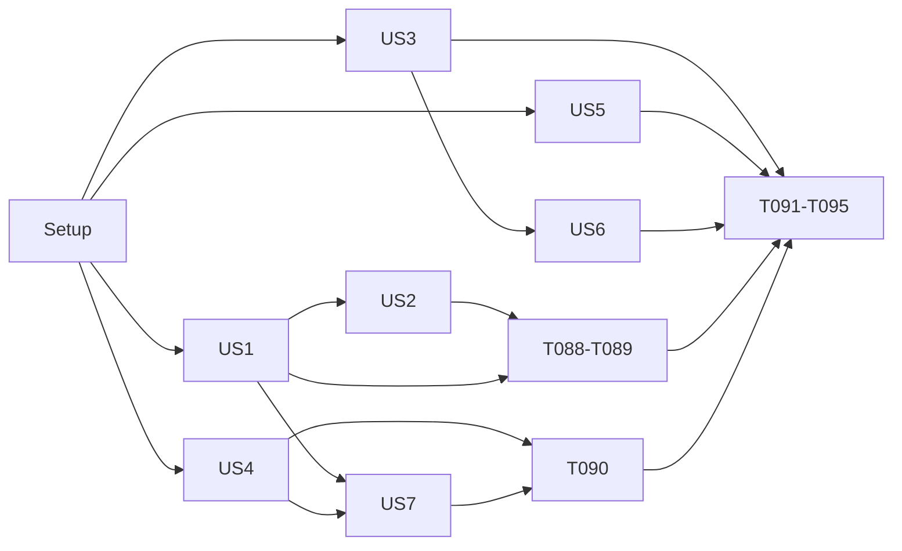

---

description: "Task list for 1.6.0: theming API, MCP write results, readable defaults, listing"
---

# Tasks: 1.6.0 Theming API, MCP Edit Feedback, Listing, and Layout Defaults

**Input**: Design documents from `/specs/023-v160-theming-mcp/`

**Prerequisites**: plan.md, spec.md, research.md, data-model.md, contracts/ (4), quickstart.md. All present.

**Tests**: Included. Constitution principle V (test-first) applies. Every story writes its failing tests first, then implements. A test task says "expect RED". Its implementation tasks make it green.

**Organization**: One phase per user story, in spec priority order. Each story covers its own requirements and can be verified on its own (see "Independent Test").

## Format: `[ID] [P?] [Story] Description`

- **[P]**: Can run in parallel (different files, no dependency on an unfinished task)
- **[Story]**: The spec user story (US1 to US7)
- Paths are repository-relative

## Path Conventions

Single Go module at the repository root. Layers: `internal/core/entities/*` (stdlib only), `internal/core/usecases/*`, `internal/adapters/*`, `internal/mcp/tools/*`, `cmd/*`. Golden regeneration: `go test ./cmd/ ./internal/adapters/{d2,hclsource,html,markdown}/ -update` (CONTRIBUTING.md), plus the projection golden test in `internal/core/usecases`.

## Shared files across stories

Several files are edited by more than one story. Do these edits in story order so they do not conflict:

| File | Stories |
|---|---|
| `internal/core/entities/arch/schemas.go`, `internal/core/entities/arch/source_model.go`, `internal/core/entities/arch/ir_element.go`, `internal/core/usecases/build_ir.go`, `internal/core/entities/authoring/edit_schema.go`, `internal/adapters/hclsource/decode_project.go` | US1 (footer), US7 (outside) |
| `internal/core/usecases/ports.go` | US1 (`RenderOptions.ThemeReport`), US3 (`SourceEditor.Diff` mode) |
| `internal/core/usecases/resolve_views.go` | US4 (layout), US7 (outside) |
| `docs/language.md` | US1, US4, US5, US6, US7 |
| `docs/guides/site-theming.md`, `docs/adr/0024-theming-api.md` | US1, US2 |
| `docs/adr/0022-readable-defaults.md` | US4, US7 |
| `testdata/projects/*/expected/projection.json` | US4 (layout), US7 (outside) |
| `internal/mcp/tools/schemas.go`, `internal/mcp/tools/helpers.go`, `docs/mcp-integration.md` | US3 (`diagnostics`, `diff`), US6 (`query` kinds, `element_kind`) |
| `internal/adapters/html/theme.go` | US1 (theme report), US2 (`fonts.css`), US7 (crossing lines) |
| `internal/adapters/html/assets_test.go`, `cmd/build_theme_test.go` | US1, US2 |
| `internal/adapters/html/render_test.go` | US1 (footer), US7 (crossing text) |
| `internal/adapters/hclsource/decode_test.go`, `internal/core/entities/arch/schemas_test.go` | US1 (footer), US7 (outside) |

---

## Phase 1: Setup (Shared Infrastructure)

**Purpose**: Start from a green, recorded baseline.

- [X] T001 Record the baseline on branch `023-v160-theming-mcp`: run `go test ./...`, `golangci-lint run` and `task audit-constitution`, and confirm `git status` shows only the untracked `examples/custom-branding/`, `loko-feedback.md` and `specs/023-v160-theming-mcp/`
- [X] T002 Build a 1.5.1 reference binary for later byte comparisons: `git worktree add /tmp/loko-151 v1.5.1 && (cd /tmp/loko-151 && go build -o /tmp/lk151 .)`

**Checkpoint**: Baseline green. `/tmp/lk151` exists for SC-007 (T090).

---

## Phase 2: Foundational (Blocking Prerequisites)

**Purpose**: None. Each story owns its own types and files (see the shared-files table for ordering). The three ADRs are written inside the stories that cause them.

**Checkpoint**: User stories can start.

---

## Phase 3: User Story 1 - Rebrand without copying built-in templates (Priority: P1) 🎯 MVP

**Covers**: FR-001, FR-002, FR-003, FR-004, FR-005 (SC-001). Contract: [theming T-1, T-2, T-3, T-6](contracts/theming.md).

**Goal**: A theme changes the logo, interface font and footer without copying any built-in block except `brand`, and the build reports the theme it applied.

**Independent Test**: Quickstart scenario 1 on a theme that overrides only `brand`, sets `--font-ui` in `custom.css`, and a project that sets `footer`.

### Tests for User Story 1 (write first, expect RED)

- [X] T003 [P] [US1] Add `TestInterfaceFontToken` in `internal/adapters/html/assets_test.go`: the built-in `style.css` declares `--font-ui` with value `"JetBrains Mono", ui-monospace, monospace` inside the first `:root {` block, the rule `code, kbd, pre` uses `var(--font-mono)`, and these selectors use `var(--font-ui)`: `th`, `.sidebar`, `.nav-section h2`, `.search-input`, `.breadcrumb ol`, `.kind-label`, `.meta`, `.pager-dir`, `.theme-toggle`, `.row-kind`, `.row-tags`, `.dir`, `.chip`, `.stat-label`, `figcaption`; expect RED
- [X] T004 [P] [US1] Add `TestBrandBlockOverride` in `internal/adapters/html/theme_test.go`: the built-in template set defines `brand`; a theme `layout.gohtml` that defines only `{{define "brand"}}` renders its brand markup, and the page still has the built-in search box, `.sidebar-nav` and `.sidebar-footer`. Leave `TestAll014BlocksStillDefined` and its `blocks014` list unchanged; expect RED
- [X] T005 [P] [US1] Add a `footer` case to `internal/adapters/hclsource/decode_test.go` (project `footer = "© Example Co."` decodes into `ProjectDecl.Footer`) and to `internal/core/entities/arch/schemas_test.go` (the `project` attributes are `description, footer, ignore_warnings, layout, loko_version` in this order); expect RED
- [X] T006 [P] [US1] Add `TestProjectFooter` in `internal/adapters/html/render_test.go`: with `Project.Footer = "© A & B <c>"` every page's `<footer class="footer"><p>` holds the escaped text `© A &amp; B &lt;c&gt;`, and with no footer the footer markup is byte-identical to the 1.5 markup in the existing golden; expect RED
- [X] T007 [P] [US1] Extend `TestBuildTheme` in `cmd/build_theme_test.go`: with `templates/custom.css` and a `templates/layout.gohtml` that defines `brand` and `footer`, stdout has the line `theme: templates/ (custom.css; layout.gohtml: brand, footer)` after the `built` line. Add `TestBuildNoThemeLine`: a project without `templates/` prints no line starting with `theme:`; expect RED
- [X] T008 [P] [US1] Extend `cmd/mcp_build_test.go`: the MCP `build` result has a `theme` object with `dir`, and `files` entries with `name` and `blocks`, for a themed copy of `examples/simple-project`, and has no `theme` field for the unthemed project; expect RED

### Implementation for User Story 1

- [X] T009 [US1] Add `--font-ui` to the light `:root` token block and re-point the 15 interface rules in `internal/adapters/html/theme/style.css` (contract T-1). Leave `code, kbd, pre` on `--font-mono`. Regenerate `internal/adapters/html/testdata/golden/assets/style.css` with `go test ./internal/adapters/html/ -update` and check that it is the only golden that changed. T003 green
- [X] T010 [US1] Move the `<div class="brand">…</div>` line out of `{{define "nav"}}` into a new `{{define "brand"}}` in `internal/adapters/html/theme/layout.gohtml`, byte for byte, and call `{{template "brand" .}}` in its place. Confirm 0 html page goldens changed and `TestAll014BlocksStillDefined`, `Test014OverridesStillBuild` and `internal/adapters/html/nav_test.go` pass unchanged. T004 green
- [X] T011 [US1] Add the `footer` attribute (`Type: AttrString`, kept in sorted position) to the `project` block in `internal/core/entities/arch/schemas.go`, `Footer string` to `ProjectDecl` in `internal/core/entities/arch/source_model.go`, and the `evalString` branch for `footer` in `internal/adapters/hclsource/decode_project.go`. T005 green
- [X] T012 [US1] Carry the footer through: `Footer string` with `json:"footer,omitempty" toon:"footer,omitempty"` on `arch.Project` in `internal/core/entities/arch/ir_element.go`, the copy in `internal/core/usecases/build_ir.go`, `Footer string` with the same tags on `ProjectHeader` in `internal/core/entities/viewmodel/page.go`, and the copy in `internal/core/usecases/project.go`
- [X] T013 [US1] Add `"footer": ValueString` to the `TargetProject` attributes in `internal/core/entities/authoring/edit_schema.go` so `internal/core/usecases/language_parity_test.go` passes
- [X] T014 [US1] Change `{{define "footer"}}` in `internal/adapters/html/theme/layout.gohtml` to `{{with .Project.Footer}}<footer class="footer"><p>{{.}}</p></footer>{{else}}<1.5 footer markup, unchanged>{{end}}` (contract T-3). Check the page data exposes `.Project.Footer`. T006 green, 0 page goldens changed
- [X] T015 [US1] Add `ThemeReport{Dir string; Files []ThemeFileReport; Assets int}` and `ThemeFileReport{Name string; Blocks []string}` with `json`/`toon` tags (`dir`, `files`, `name`, `blocks,omitempty`, `assets,omitempty`) to `internal/core/entities/viewmodel/artifact.go` next to `ThemeFile`
- [X] T016 [US1] Add `ThemeReport *viewmodel.ThemeReport` to `RenderOptions` in `internal/core/usecases/ports.go`. `RenderOptions` is passed by value, so `loadRenderOptions` in `internal/core/usecases/build_site.go` allocates it (`&viewmodel.ThemeReport{Dir: "templates/"}`) when the theme has at least one file, and leaves it nil otherwise. In `internal/adapters/html/theme.go` `applyOverrides`, fill that pointer from the blocks each `.gohtml` override defines (the `probe.Templates()` result at about line 92): files sorted by name, blocks sorted, non-template files listed with no blocks. When html is not built, the report keeps the file list with no blocks
- [X] T017 [US1] Add `Theme *viewmodel.ThemeReport` (`json:"theme,omitempty" toon:"theme,omitempty"`) to `BuildResult` in `internal/core/usecases/build_artifacts.go` and to `ProjectBuildResult` in `internal/core/usecases/build_in_project.go`, set to `opts.ThemeReport` after rendering, so it is nil when the project has no `templates/`. T008 green
- [X] T018 [US1] Print the theme line in `printBuildSummary` in `cmd/build.go` after the `built` line, in the format of contract T-6 (files sorted, `file: block, block` for templates, `"; "` separators, `assets/: N files` last when `Assets > 0`). Keep the function within 50 effective lines; move formatting to a helper in `cmd/build.go` if needed. T007 green
- [X] T019 [P] [US1] Document `--font-ui` (Type row), the `brand` block (layout.gohtml row), the project `footer` and the theme line in `docs/guides/site-theming.md`, and add `brand` and `--font-ui` to its "Stable classes, variables, and blocks" section
- [X] T020 [P] [US1] Add `footer` to the `project` attribute table in `docs/language.md` with the note "plain text shown by the built-in site footer"
- [X] T021 [P] [US1] Amend `specs/014-viewmodel-renderers/contracts/theme.md` and `specs/021-site-redesign/contracts/theme-blocks.md` with the `brand` block and a link to `specs/023-v160-theming-mcp/contracts/theming.md`
- [X] T022 [US1] Write `docs/adr/0024-theming-api.md` from `docs/adr/template.md`, in the ADR-0016 style: context (feedback items 7, 11, 12, 13), decisions T-1, T-2, T-3, T-6, consequences. US2 adds T-4 and T-5 in T035

**Checkpoint**: Quickstart scenario 1 passes with a theme that overrides only `brand`. `go test ./internal/adapters/html/ ./cmd/ ./internal/core/...` green.

---

## Phase 4: User Story 2 - A theme ships its own files and fonts (Priority: P1)

**Covers**: FR-006, FR-007, FR-008, FR-009, FR-010 (SC-002, SC-003). Contract: [theming T-4, T-5](contracts/theming.md).

**Goal**: `templates/assets/**` is published under `assets/theme/`, and a theme `fonts.css` replaces the built-in fonts.

**Independent Test**: Quickstart scenario 2, including the negative case.

### Tests for User Story 2 (write first, expect RED)

- [X] T023 [P] [US2] Add `TestLoadThemeAssets` in `internal/adapters/projectfs/theme_test.go`: files under `templates/assets/` at any depth are returned with `Rel` = `assets/<path>` and unchanged bytes, top-level `.gohtml/.css/.js` files keep `Rel` empty, a symbolic link under `templates/assets/` is returned with `Link: true` and no bytes (not followed), and other top-level extensions are still ignored; expect RED
- [X] T024 [P] [US2] Add asset cases to `internal/core/entities/viewmodel/theme_rules_test.go`: an asset `Rel` that fails `SafePath` (absolute, `..`, backslash, drive letter, control character) and two asset paths that differ only in letter case each give one problem naming `templates/<Rel>`; `fonts.css` is now a valid top-level name; expect RED
- [X] T025 [P] [US2] Extend `cmd/build_theme_test.go`: (a) `templates/assets/img/mark.svg` is published byte-identical at `dist/assets/theme/img/mark.svg`; (b) removing it and rebuilding prunes it and reports it in `removed`; (c) a case-colliding pair `templates/assets/A.svg` and `templates/assets/a.svg` fails with `theme_invalid` naming the file and leaves the `dist/` hash tree unchanged (reuse the hash-tree assertion already in this file); (d) an asset `templates/assets/style.css` is published at `dist/assets/theme/style.css` and `dist/assets/style.css` stays the built-in stylesheet; expect RED
- [X] T026 [P] [US2] Add `TestFontsOverride` in `internal/adapters/html/assets_test.go`: with a theme `fonts.css`, `assets/fonts.css` is the theme bytes plus the generated-file notice, holds no `woff2` data, and `assets/brand/madstone-eye.svg` and `assets/LICENSES.txt` are still written; without it, `TestAssetsPublished` and `TestFontBudget` still pass; expect RED

### Implementation for User Story 2

- [X] T027 [US2] Add `Rel string` (path below `templates/`, empty for top-level files) and `Link bool` (the entry is a symbolic link, which validation refuses) to `ThemeFile` in `internal/core/entities/viewmodel/artifact.go`
- [X] T028 [US2] Change `LoadTheme` in `internal/adapters/projectfs/theme.go` to read the top-level files as today and walk `templates/assets/` with `fs.WalkDir`, returning every regular file with `Rel` = `assets/<slash path>` and `Origin` = `templates/assets/<slash path>`, unchanged bytes. Return a symbolic link as a `ThemeFile` with `Link: true` and no bytes, so validation reports it (T029). Keep the file within 400 effective lines. T023 green
- [X] T029 [US2] Add `"fonts.css"` to the valid names, and an asset check, in `internal/core/entities/viewmodel/theme_rules.go`: every asset `Rel` below `assets/` must pass `SafePath`, no asset may have `Link: true`, and lower-cased asset paths must be unique. Problems name `ThemeFile.Origin` and stay sorted. T024 green
- [X] T030 [US2] Validate the theme (top-level names and assets) in `loadRenderOptions` in `internal/core/usecases/build_site.go`, which every build path calls before any backend renders (`build_artifacts.go:100`). Return `theme_invalid` diagnostics so nothing is committed. An invalid asset now fails a `--formats d2` build too (contract T-4)
- [X] T031 [US2] Publish assets in `internal/adapters/html/render.go` (`assetArtifacts`): one `vm.Artifact{Path: "assets/theme/" + strings.TrimPrefix(Rel, "assets/"), Bytes: <raw bytes>}` per asset, with no generated-file notice. Set `ThemeReport.Assets` to the asset count. Keep the top-level override files out of this path
- [X] T032 [US2] Split `brandArtifacts` in `internal/adapters/html/fonts.go` into the built-in `fonts.css` artifact and the brand artifacts (`assets/brand/madstone-eye.svg`, `assets/LICENSES.txt`). Add `fonts.css` to `overridable` in `internal/adapters/html/theme.go`. In `assetArtifacts`, when the theme has `fonts.css`, emit it with the notice (as other CSS overrides) and skip the built-in one. `icons.css` stays generated. T026 green
- [X] T033 [US2] Confirm T025 green: `go test ./cmd/ -run TestBuildTheme` (pruning needs no new code: theme artifacts go through `Store.Commit` and the manifest)
- [X] T034 [P] [US2] Document `templates/assets/` (published at `assets/theme/`, referenced as `url("theme/…")` from a stylesheet) and the `fonts.css` override in `docs/guides/site-theming.md`, and remove "`fonts.css` … cannot be overridden" there. Update the same rows in `specs/014-viewmodel-renderers/contracts/theme.md` and `specs/021-site-redesign/contracts/theme-blocks.md` (`icons.css` stays not overridable)
- [X] T035 [US2] Add decisions T-4 and T-5, the contract reversal for `fonts.css`, and the "assets validated even without html" consequence to `docs/adr/0024-theming-api.md`

**Checkpoint**: Quickstart scenario 2 passes. US1 and US2 together give the full theming surface.

---

## Phase 5: User Story 3 - An assistant gets only the feedback its change caused (Priority: P2)

**Covers**: FR-012, FR-013, FR-014, FR-015, FR-016 (SC-004, SC-005). Contract: [mcp-write-results W-1 to W-5](contracts/mcp-write-results.md).

**Goal**: `apply_edit`, `move` and `fmt` return a diagnostic delta by default, and `apply_edit` and `move` return a meaning diff by default. Both 1.5 shapes stay one argument away.

**Independent Test**: Quickstart scenario 3 on `testdata/projects/first-run`.

### Tests for User Story 3 (write first, expect RED)

- [X] T036 [P] [US3] Add `internal/core/usecases/edit_delta_test.go` (table-driven, `t.Parallel()`): key = `code|severity|address|file|detail`; a diagnostic whose lines shift is unchanged; a removed element's diagnostic is in removed with its pre-change position; a new one is in added; two diagnostics with equal keys pair in source order; no change gives empty added and removed with correct counts; counts are per severity (`errors`, `warnings`, `info`) and nil when all are 0; expect RED
- [X] T037 [P] [US3] Extend `internal/core/usecases/apply_edits_test.go`: a successful `Apply` sets `Added`, `Removed` and unchanged counts; a refusal keeps the full `Diags` of the refused compile; `Move` (through `MoveRequest`) behaves the same. Extend `internal/core/usecases/format_plan_test.go`: a successful `Format` sets unchanged counts and empty added and removed; expect RED
- [X] T038 [P] [US3] Add whitespace cases to `internal/adapters/hclsource/edit_diff_test.go`: with `DiffMeaning`, a realigned sibling attribute (`system = system.s` → `system      = system.s`) becomes a context line listed in `Whitespace` by its new line number, a line that changes both meaning and whitespace stays a `-`/`+` pair, a hunk with only whitespace changes is dropped, whitespace inside string literals counts as meaning; with `DiffExact` the diff is byte-identical to 1.5; expect RED
- [X] T039 [P] [US3] Extend `internal/mcp/tools/schemas_test.go` for the new properties: `diagnostics` (`changed|all`, default `changed`) on `apply_edit`, `move`, `fmt`; `diff` (`meaning|exact`, default `meaning`) on `apply_edit` and `move` only; expect RED
- [X] T040 [P] [US3] Add `TestWriteResultSize` in `internal/mcp/tools/read_tools_test.go`, modelled on `TestCompactDiagnosticsSize`: on `first-run`, an `apply_edit` preview that sets one description, encoded with defaults, is at most half the size of the same call with `diagnostics: "all"` and `diff: "exact"` (SC-004), and has no `diagnostics` field; expect RED
- [X] T041 [P] [US3] Add `TestOneAttributeEditDiff` in `internal/mcp/tools/apply_edit_test.go`: setting one attribute on a block whose siblings realign gives a `files[0].diff` with exactly one `+` line and a non-empty `files[0].whitespace` (SC-005); a refused edit still returns `refusal` and the full `diagnostics` (FR-015); expect RED

### Implementation for User Story 3

- [X] T042 [US3] Add `internal/core/usecases/edit_delta.go` (about 70 lines, within budget): `diagnosticDelta(before, after arch.Diagnostics) (added, removed arch.Diagnostics, unchanged DiagnosticCounts)` and `type DiagnosticCounts struct{ Errors, Warnings, Info int }` with tags `errors,omitempty`, `warnings,omitempty`, `info,omitempty`. T036 green
- [X] T043 [US3] Extend `EditResult` in `internal/core/usecases/authoring_service.go` with raw `Added`, `Removed` (`json:"-"`) and encoded `DiagnosticsAdded`, `DiagnosticsRemoved` (`[]DiagnosticView`, `diagnostics_added,omitempty`, `diagnostics_removed,omitempty`) and `DiagnosticsUnchanged *DiagnosticCounts` (`diagnostics_unchanged,omitempty`, nil when the total is 0). Replace `EditResult.ShapeDiagnostics(full)` in `internal/core/usecases/validate_filter.go` with `ShapeEdit(full, all bool)`: refusal → full `diagnostics`; `all` → `diagnostics` only (1.5 shape); otherwise → the three delta fields
- [X] T044 [US3] In `internal/core/usecases/apply_plan.go`, keep the before compile result (`ir, before, err := compileIR(...)`) and change `finish` to take `before, after arch.Diagnostics`, computing the delta for applied, preview and no-op results. Refusals unchanged. Keep `Diags` as the full after set so existing tests that read it still pass
- [X] T045 [US3] Replace the positional `Move(ctx, from, to, base string, preview bool)` in `internal/core/usecases/apply_edits.go` with `Move(ctx, MoveRequest)` (`From`, `To`, `BaseRevision`, `Preview`, `ExactDiff`), and add `ExactDiff bool` to `ApplyRequest`. Update every caller (`internal/mcp/tools/move.go`, tests)
- [X] T046 [US3] In `internal/core/usecases/format_plan.go`, compile once after formatting with `compileOverlay(ctx, s.deps, files)` and pass the result as both before and after to `finish`, so `fmt` returns counts (contract W-2). T037 green
- [X] T047 [US3] Add `type DiffMode int` with `DiffMeaning` and `DiffExact`, and `Whitespace []int` (`json:"whitespace,omitempty"`) on `FileChange`, in `internal/core/entities/authoring/plan.go`. Change `SourceEditor.Diff(plan)` to `Diff(plan Plan, mode authoring.DiffMode)` in `internal/core/usecases/ports.go`, and update the fake in `internal/core/usecases/authoring_mocks_test.go`
- [X] T048 [US3] Add `internal/adapters/hclsource/edit_diff_whitespace.go`: after `myers(a, b)`, re-diff each maximal run of `-` and `+` lines on copies with whitespace outside `"…"` (honouring `\"`) removed; matched pairs become context ops with the new text and their new line numbers go to `Whitespace`. Call it from `Editor.Diff` in `internal/adapters/hclsource/edit_diff.go` only for `DiffMeaning`; list a file when its diff is not empty or it has whitespace lines. T038 green
- [X] T049 [US3] Pass the mode through: `applyBatch`/`finish` call `Editor.Diff(plan, mode)` with `DiffExact` when `ExactDiff` is set, else `DiffMeaning`; `Format` always uses `DiffExact`
- [X] T050 [US3] Add `diagnosticsProp` (enum `changed`, `all`, default `changed`) and `diffProp` (enum `meaning`, `exact`, default `meaning`) to `internal/mcp/tools/schemas.go`; add `diagnostics` to `ApplyEditSchema`, `MoveSchema`, `FmtSchema` and `diff` to `ApplyEditSchema`, `MoveSchema`. T039 green
- [X] T051 [US3] Add `encodeEdit(enc, res *usecases.EditResult, args)` to `internal/mcp/tools/helpers.go` (reads `format`, `ranges`, `diagnostics`, calls `ShapeEdit`), and a helper that reads `preview` and `diff` into the request. Use them in `internal/mcp/tools/apply_edit.go`, `move.go` and `fmt.go`; keep each handler function within 30 effective lines. `describe`, `query` and `build` keep `encodeShaped`. T040 and T041 green
- [X] T052 [P] [US3] Update `docs/mcp-integration.md`: the `apply_edit`, `move` and `fmt` parameter tables (`diagnostics`, `diff`), the result description (`diagnostics_added`, `diagnostics_removed`, `diagnostics_unchanged`, `files[].whitespace`) and how to get the 1.5 shapes
- [X] T053 [US3] Write `docs/adr/0023-mcp-write-results.md` in the ADR-0016 style: context (feedback item 3), the delta and its key, the meaning diff, `diagnostics: "all"` and `diff: "exact"` as the way back, refusals unchanged, the new `fmt` compile, the measured sizes from T040, and the known misclassifications (rename, changed suggestion text)

**Checkpoint**: Quickstart scenario 3 passes. `go test ./internal/core/usecases/ ./internal/adapters/hclsource/ ./internal/mcp/... ./cmd/` green, including `cmd/authoring_perf_test.go`.

---

## Phase 6: User Story 4 - Diagrams are readable without tuning the layout (Priority: P2)

**Covers**: FR-017, FR-018, FR-019, FR-020 (SC-006). Contract: [rendering-defaults R-1, R-2, R-4](contracts/rendering-defaults.md).

**Goal**: elk draws every view with no layout, `layout = "dagre"` gives 1.5, and the hint advice matches the new default.

**Independent Test**: Quickstart scenario 4.

### Tests for User Story 4 (write first, expect RED)

- [X] T054 [P] [US4] Update `TestViewLayouts` in `internal/core/usecases/project_layout_test.go`: a view with no layout on the view or project resolves to `"elk"`, a project `layout = "dagre"` resolves to `"dagre"`, a view layout wins over the project; update the test's doc comment; expect RED
- [X] T055 [P] [US4] Update `internal/adapters/d2/emit_layout_test.go`: the emitter always writes `vars.d2-config.layout-engine` (`elk` or `dagre`), falls back to `elk` for an empty `View.Layout`, and writes none for a sequence-style view; expect RED
- [X] T056 [P] [US4] Update `internal/core/usecases/wide_view_test.go` lines 30 and 32 to the contract R-2 texts (`The project uses the default layout, elk. Set layout = "dagre" on the project …` and `Try direction = "right" or layout = "dagre" on the view.`); keep the project-layout-set case at line 41; expect RED

### Implementation for User Story 4

- [X] T057 [US4] In `internal/core/usecases/resolve_views.go`, set `View.Layout = cmp.Or(view layout, project layout, arch.LayoutElk)` for generated (about line 59) and declared (about line 107) views and delete `layoutFor` (lines 128-135). Update the `"" means dagre` comments in `internal/core/entities/arch/source_model.go`, `internal/core/entities/viewmodel/view.go`, `internal/core/entities/arch/render_attrs.go` and the `layout` note in `internal/core/entities/arch/schemas.go` to say elk is the default. T054 green
- [X] T058 [US4] In `internal/adapters/d2/emit.go` (lines 32-35), always write `layout-engine` with `cmp.Or(m.View.Layout, "elk")`, as `direction` does at line 31; update the comment in `internal/adapters/d2/svg_backend.go` (lines 212-217). T055 green; confirm the 9 d2 goldens under `internal/adapters/d2/testdata/golden` are unchanged or change only by the engine line, and review any change
- [X] T059 [US4] Change the no-layout branches in `internal/core/usecases/wide_view.go` (about lines 70-74 and 88) to the contract R-2 texts; no semicolons, no contractions. T056 green
- [X] T060 [US4] Set `layout = "dagre"` on the project that `writeLargeProject` generates in `cmd/build_perf_test.go`, with a comment citing ADR-0022 and the measured elk cost; run `go test ./cmd/ -run TestPerformanceBuild` without `-short`
- [X] T061 [US4] Measure the edit-to-browser time with elk on the `cmd/build_perf_test.go` project (temporary local run without the dagre line) and record the number in `specs/023-v160-theming-mcp/research.md` R9, replacing the [INFERENCE] line. If it is over 2 s, record it in `docs/adr/0022-readable-defaults.md` as a known cost of the default: the 2 s budget stays enforced on the dagre path (T060)
- [X] T062 [US4] Regenerate `testdata/projects/*/expected/projection.json` with the projection golden test's update flag in `internal/core/usecases` and confirm the only change is `"layout": "elk"` on each view (6 files)
- [X] T063 [US4] Verify SC-006 on `testdata/projects/first-run` (no layout): for each view SVG, compute page-width text size as in ADR-0021 (label font size × page width ÷ viewBox width, page width as used there) and record the table in `docs/adr/0022-readable-defaults.md`; every view must be at least 6 px or larger than under dagre, and the narrowest view must improve (SC-006 as amended)
- [X] T064 [P] [US4] Update `docs/language.md` (`layout` on project and view: default `elk`, and `dagre` for very large models, with the measured cost), and write the layout half of `docs/adr/0022-readable-defaults.md`: context (feedback item 1), decision R-1, hint text R-2, measurements R-4 and T061, consequences. Do not edit ADR-0015: accepted ADRs are not changed, and ADR-0022 says which part of ADR-0015 §6 it replaces

**Checkpoint**: Quickstart scenario 4 passes. `go test ./...` green including the perf test.

---

## Phase 7: User Story 5 - The author learns about a redundant relationship (Priority: P2)

**Covers**: FR-021, FR-022. Contract: [query-and-diagnostics Q-2](contracts/query-and-diagnostics.md).

**Goal**: `redundant_relationship` (information) on a container relationship that one of its own components repeats with exactly the same target.

**Independent Test**: Quickstart scenario 5.

### Tests for User Story 5 (write first, expect RED)

- [X] T065 [P] [US5] Add `internal/core/usecases/validate_redundant_test.go`: same target from a container and its own component fires once on the container relationship with one `Related` entry; two components repeating it give two `Related` entries sorted by address; a component of a different container does not fire; a component targeting a child of the container's target does not fire; different kinds add `The kinds differ: sync and async.`; the detail has no semicolons; expect RED
- [X] T066 [P] [US5] Extend `internal/core/usecases/compile_ignore_test.go` (suppressed by `ignore_warnings` and by `--ignore`, and `--strict` keeps it information), `internal/core/entities/arch/diagnostic_test.go` (`TestAllCodesAreKnown` count 37 → 38) and `internal/core/usecases/rule_coverage_test.go` (a fixture for the new code); expect RED

### Implementation for User Story 5

- [X] T067 [US5] Add `CodeRedundantRelationship = "redundant_relationship" // info` under a 1.6.0 comment in `internal/core/entities/arch/diagnostic.go`, to `AllCodes` after `CodeWideView`, and to `IgnorableCodes` in `internal/core/entities/arch/diagnostic_ignore.go` in the same order. Do not add it to `strictWarnings`
- [X] T068 [US5] Add `internal/core/usecases/validate_redundant.go` with exported `ValidateRedundantRelationships(model, res) arch.Diagnostics`: index container relationships by container and resolved target, match component relationships through `res.Parent`, exact addresses only, severity information, summary `Relationship repeats a component relationship`, detail as in contract Q-2, address and range of the container relationship, `Related` per component relationship. Call it from `CompileArchitecture` in `internal/core/usecases/compile_architecture.go`, on the line after `ValidateWarnings` (about line 73), so `validate_warnings.go` keeps its line count. Confirm `task audit-constitution` passes. T065 and T066 green
- [X] T069 [P] [US5] Add `redundant_relationship` to the Information table of the diagnostics reference in `docs/language.md`, with what it means and how to fix it

**Checkpoint**: Quickstart scenario 5 passes.

---

## Phase 8: User Story 6 - List views, elements and relationships (Priority: P3)

**Covers**: FR-023, FR-024. Contract: [query-and-diagnostics Q-1](contracts/query-and-diagnostics.md).

**Goal**: `query views`, `query elements [--kind]` and `query relationships` in the CLI and MCP.

**Independent Test**: Quickstart scenario 6.

### Tests for User Story 6 (write first, expect RED)

- [X] T070 [P] [US6] Extend `internal/core/usecases/query_test.go`: `views` lists generated and declared views sorted by name with kinds `landscape|system|container|deployment|declared` and a shadowed generated view replaced; `elements` lists every element sorted by address with `title`, and `ElementKind: "container"` filters; an unknown `ElementKind` gives `invalid_query` listing `person, system, container, component, external`; `relationships` lists every relationship sorted by address with kind `sync` when empty; existing kinds' results are unchanged; expect RED
- [X] T071 [P] [US6] Extend `TestQueryMatchesMCP` in `cmd/query_test.go` with `views`, `elements`, `elements --kind container` and `relationships` (map `element_kind` in the args builder), and add text-table tests with the headers `NAME KIND TITLE`, `ADDRESS KIND TITLE`, `ADDRESS SOURCE TARGET KIND DESCRIPTION`; `TestCommandSurface` in `cmd/root_test.go` stays unchanged; expect RED

### Implementation for User Story 6

- [X] T072 [US6] Add `internal/core/usecases/query_list.go`: `ViewRow{Name, Kind, Title}`, `RelationshipRow{Address, Source, Target, Kind, Description}` (`description,omitempty`), and the three listings over the IR (views from `ResolveViews(ir, Provenance{})` re-sorted by id). Add `ElementKind` to `QueryRequest`, `Views` and `Relationships` (`omitempty`) to `QueryResult`, and `Title string` (`json:"title,omitempty"`) to `ElementHit` in `internal/core/usecases/query.go`; add the three kinds to `QueryIR` and `checkQuery` (no address; update the kind list in the error text). T070 green
- [X] T073 [US6] In `cmd/query_cobra.go`, register `views` and `relationships` with `querySubcommand(..., cobra.NoArgs)` and `elements` with a `--kind` flag; add `Example` lines. In `cmd/query.go` `writeQueryText`, add the three text tables. Keep each handler within 50 effective lines
- [X] T074 [US6] In `internal/mcp/tools/schemas.go`, add `views`, `elements`, `relationships` to the `query` `kind` enum and an `element_kind` property (enum of the five logical kinds); read it in `queryRequest` in `internal/mcp/tools/helpers.go`; update the `query` tool description. T071 green
- [X] T075 [P] [US6] Document the listing in `docs/cli-reference.md` (`loko query views|elements|relationships`), `docs/mcp-integration.md` (`query` kinds and `element_kind`) and `docs/llm/patterns.md` (the question table)

**Checkpoint**: Quickstart scenario 6 passes.

---

## Phase 9: User Story 7 - Deployment views show each outside endpoint (Priority: P3)

**Covers**: FR-025, FR-026. Contract: [rendering-defaults R-3](contracts/rendering-defaults.md).

**Goal**: Deployment views draw one outside node per outside element by default. `outside = "collapsed"` on the project or a `deployment` block gives 1.5.

**Independent Test**: Quickstart scenario 7.

### Tests for User Story 7 (write first, expect RED)

- [X] T076 [P] [US7] Add `outside` cases: `internal/adapters/hclsource/decode_test.go` (`outside` on `project` and `deployment` decode), `internal/core/usecases/validate_render_attrs_test.go` (`outside = "sideways"` gives `invalid_attribute_value` listing `expanded, collapsed`), and `internal/core/entities/arch/schemas_test.go` (`outside` on `project` and `deployment`, not on `view`); expect RED
- [X] T077 [P] [US7] Extend `internal/core/usecases/project_deployment_test.go`: a deployment view whose instances link to three outside elements has three outside nodes with ids `outside__<node id>`, labels = element titles, role outside, no address; a component endpoint lifts to its container; `outside = "collapsed"` on the project, or on the `deployment` block over an `expanded` project, gives the single `outside` node and the 1.5 edges; system, container and declared views keep one outside node; expect RED
- [X] T078 [P] [US7] Update `internal/core/entities/viewmodel/model_test.go`: several outside nodes are valid; an outside node with no crossing edge is invalid; a crossing is decided by the endpoint's outside role; expect RED
- [X] T079 [P] [US7] Add crossing-text tests in `internal/adapters/html/render_test.go` and `internal/adapters/markdown/backend_test.go`: expanded edges read `api → Ledger (outside): Records payments` (markdown `**api** → Ledger (outside): …`); collapsed edges keep the 1.5 text byte for byte; expect RED

### Implementation for User Story 7

- [X] T080 [US7] Add `OutsideModes = []string{"expanded", "collapsed"}` to `internal/core/entities/arch/render_attrs.go`; `outside` (with `Values: OutsideModes` and the note "deployment views: one node per outside element (expanded, the default) or one shared node (collapsed)") to the `project` and `deployment` blocks in `internal/core/entities/arch/schemas.go`; `Outside` and `OutsideRange` to `ProjectDecl` and `EnvironmentDecl` in `internal/core/entities/arch/source_model*.go`; decoding in `internal/adapters/hclsource/decode_project.go` and `internal/adapters/hclsource/decode_deployment.go`; validation in `internal/core/usecases/validate_render_attrs.go`; the authoring attributes in `internal/core/entities/authoring/edit_schema.go`. T076 green
- [X] T081 [US7] Carry the value: `Outside string` (`omitempty`) on `arch.Project` (`ir_element.go`) and `arch.Environment` (`ir_deployment.go`), copied in `internal/core/usecases/build_ir.go`; `View.Outside string` (`json:"outside,omitempty"`) in `internal/core/entities/viewmodel/view.go`, set by `derivedViews` in `internal/core/usecases/resolve_views.go` for deployment views to `"collapsed"` when `cmp.Or(env.Outside, project.Outside) == "collapsed"`, else empty
- [X] T082 [US7] Add `OutsideNodeIDFor(addr arch.Address) string` = `OutsideNodeID + "__" + NodeIDFor(addr)` in `internal/core/entities/viewmodel/model.go`, and change `ViewModel.Validate` (about lines 116-118 and 150-152) to decide crossing by `RoleOutside`, allow several outside nodes, and require each to have a crossing edge. T078 green
- [X] T083 [US7] In `internal/core/usecases/project_lift.go`, give `liftEdges` a function that maps the invisible endpoint (after the trigger swap) to an outside node id, and return the outside ids used; add `outsideNodes(ir, used)` building the collapsed node (existing `outsideNode()`) or expanded nodes (`Role: RoleOutside`, `Kind`, `Label: cmp.Or(title, name)`, outside style, no `Address`). Update the 9 `liftEdges` calls in `internal/core/usecases/project_lift_test.go` and `project_lift_kind_test.go`
- [X] T084 [US7] Change `finishView` in `internal/core/usecases/project_view.go` to take the outside nodes instead of `outside bool`, and update its callers: `projectSubject` (always collapsed), `projectDeployment` in `internal/core/usecases/project_deployment.go` (expanded unless `View.Outside == "collapsed"`, component endpoints lifted to their container), and `projectDeclared` in `internal/core/usecases/select_declared.go` (always collapsed). Keep `project_view.go` within 200 effective lines. T077 green
- [X] T085 [US7] Find the crossing direction by the endpoint node's role in `crossingLines` in `internal/adapters/html/theme.go` and in the "Leaves this view" list in `internal/adapters/markdown/backend.go`; keep the collapsed text byte-identical and use the expanded text of contract R-3. T079 green
- [X] T086 [US7] Regenerate goldens and review each diff: `testdata/projects/{two-systems,deployment-details,deployment-nested}/expected/projection.json`, `internal/adapters/html/testdata/golden/view/deployment-{prod,staging}.html`, `internal/adapters/html/testdata/golden/deployment-details/view/deployment-{dev,prod}.html`, `internal/adapters/markdown/testdata/golden/md/view/deployment-{prod,staging}.md`. Update the staging d2 assertion in `cmd/build_test.go` (about line 134). No other golden may change
- [X] T087 [P] [US7] Document `outside` on `project` and `deployment` in `docs/language.md` (values, default, that declared views do not take it), and add the outside-endpoint half to `docs/adr/0022-readable-defaults.md` (context feedback item 6, decision R-3, the 9 changed goldens listed in T086, way back `outside = "collapsed"`)

**Checkpoint**: Quickstart scenario 7 passes. All seven stories done.

---

## Phase 10: Polish & Cross-Cutting Concerns

**Purpose**: The branded example, the release checks and the changelog.

- [X] T088 Update `examples/custom-branding/` to use every theming addition (FR-011): `templates/layout.gohtml` defines only `brand` (the Example Co. mark as ``); `templates/assets/mark.svg` holds the mark that is now a data URI; `templates/custom.css` sets `--font-ui` and drops the per-selector font overrides and the data URI; `templates/fonts.css` loads an OFL-licensed web font from `templates/assets/fonts/` (ship its license text beside it); `main.loko.hcl` sets `footer = "© Example Co."`; update `examples/custom-branding/README.md`. Check SC-001 and SC-002: `grep -c base64 templates/custom.css` is 0 and only `brand` is overridden
- [X] T089 Build and validate the example with the branch binary, then check it in the browser in light and dark mode: mark, interface font, code font, footer, and the `theme:` line in the build output. Delete `dist/` and `.dist.loko/` after, and confirm `CI`'s "Validate Examples" job picks the example up (add it to the job's list if the workflow names examples explicitly)
- [X] T090 Verify SC-007: build `testdata/projects/two-systems` with `layout = "dagre"` and `outside = "collapsed"` on the project, with `/tmp/lk151` and with the branch binary, and `diff -r` the two outputs; the only allowed differences are `assets/style.css` (the `--font-ui` token, contract T-1) and `.d2` files gaining an explicit `layout-engine: dagre` line. Record the result in the PR description. Result: after normalizing d2's source-hash class names (`d2-<n>`), the only differences are `assets/style.css` (T-1), the 7 `.d2` engine blocks (R-1), the d2 hash names that follow from them, and `index.html` gaining "1 info" from `redundant_relationship` on this fixture (content added by 1.6)
- [X] T091 Run every quickstart scenario (1 to 7) end to end with the branch binary, including the negative asset case and the MCP calls over stdio
- [X] T092 Run the full gates: `go test ./...` (perf tests not skipped), `golangci-lint run`, `task audit-constitution`, core coverage above 80%, then regenerate all goldens and confirm every changed golden traces to T009, T062 or T086
- [X] T093 Write `## [1.6.0]` in `CHANGELOG.md` in the house style (FR-028): one motivating sentence, `### Added` (font token, brand block, footer, theme assets, fonts override, theme line, listing, `redundant_relationship`, `outside`) and `### Changed` (elk default with the measured cost and `layout = "dagre"`, expanded outside endpoints with `outside = "collapsed"`, MCP write results with `diagnostics: "all"` and `diff: "exact"`, `fmt` returns counts), each citing its feedback item and ADR, and the `[1.6.0]` compare link. Verify every in-scope item (1, 3, 4, 6, 7, 8, 9, 11, 12, 13, 18) is cited (SC-008), and that every language addition (`footer`, `outside`) is in `docs/language.md` and in the MCP `schema` output (FR-027): run `loko mcp` and call `schema` for `project` and `deployment`
- [X] T094 Run a PII and client-name scan before the PR: `git grep -niE` for the terms removed in 1.5.1 over the whole tree, and confirm the example stays generic
- [ ] T095 Open the PR into `main` from `023-v160-theming-mcp` with the spec link, the three ADRs, the golden list and the T090 result; after merge and green `main` CI, tag `v1.6.0`, push the tag and the `release/1.6.0` branch, and confirm the release and the Homebrew cask bump

---

## Dependencies & Execution Order

### Phase Dependencies

- **Setup (Phase 1)**: none.
- **Foundational (Phase 2)**: empty.
- **User stories (Phases 3 to 9)**: each can start after Setup. Shared files (table above) need the stated order.
- **Polish (Phase 10)**: T088 and T089 need US1 and US2. T090 needs US4 and US7. T091 to T095 need every story.

### User Story Dependencies



- **US2 after US1**: both edit `docs/guides/site-theming.md`, `docs/adr/0024-theming-api.md` and `internal/adapters/html/theme.go`, and US2's `ThemeReport.Assets` uses the type from T015.
- **US7 after US1**: both edit the `project` schema, declaration, IR and authoring files.
- **US7 after US4**: both edit `resolve_views.go`, `docs/adr/0022-readable-defaults.md` and the `projection.json` goldens.
- **US3, US5** are independent of every other story. US3 touches `ports.go` after US1's `RenderOptions` edit (a one-line conflict at most).
- **US6 after US3**: both edit `internal/mcp/tools/schemas.go`, `internal/mcp/tools/helpers.go` and `docs/mcp-integration.md`. US6 adds the `query` properties after US3 adds `diagnostics` and `diff`.

### Within Each User Story

Tests (RED) → entity and type changes → use cases → adapters → handlers → docs and ADR → checkpoint.

### Parallel Opportunities

- All `[P]` test tasks inside a story run together (they touch different test files).
- Across stories, three independent tracks: {US1 → US2 → US7 after US4}, {US3 → US6}, {US4, US5}.
- Docs tasks marked `[P]` run beside implementation once the behavior is fixed.

## Parallel Example: first wave

```bash
# Track A (theming): T003–T008 in parallel, then T009–T022
# Track B (MCP):     T036–T041 in parallel, then T042–T053; then US6 T070–T075
# Track C (defaults and checks): US4 T054–T056 and US5 T065–T066 in parallel
```

## Implementation Strategy

### MVP First (User Story 1 only)

1. Phase 1 baseline.
2. US1: `--font-ui`, `brand`, `footer`, theme line.
3. Stop and validate with quickstart scenario 1. US1 alone closes feedback items 7, 11, 12 and 13 with no change to default output except one CSS golden.

### Incremental Delivery

1. US1 + US2 → the complete theming API (P1).
2. US3 → MCP token savings (P2, independent).
3. US4 → elk default, then US7 → expanded endpoints (both default changes, one ADR).
4. US5, US6 → diagnostics and listing (small, independent).
5. Polish → example, SC-007 byte check, changelog, release.

### Default-change guard

Three stories change default output: US3 (ADR-0023), US4 and US7 (ADR-0022). Each keeps its 1.5 shape one setting away: `diagnostics: "all"` with `diff: "exact"`, `layout = "dagre"`, `outside = "collapsed"`. T090 checks the layout and outside opt-outs byte for byte. T040 and T041 check the MCP ones.

## Notes

- `[P]` = different files, no dependency on an unfinished task.
- Commit after each story checkpoint.
- Every golden change names the task that caused it (T009, T062, T086). Any other golden change is a bug.
- New use-case files exist because `validate_warnings.go`, `query.go` and `project_view.go` are at or near the 200-line budget.
